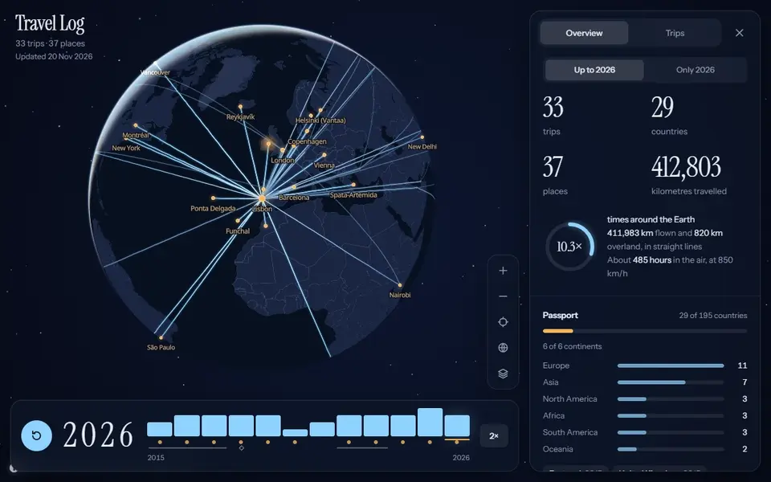

# Travel Log



Personal travel history tracker and visualizer: flights and overland trips, for several people.

Inspired by [Fog of World](https://fogofworld.app/) and [Flighty](https://flighty.com/).

---

## How It Works

**Visualize** — flights render as great-circle routes (fading in from where you left to where you landed) and overland legs as dashed lines on an interactive globe. Zoom from the whole planet down to city streets: the map is vector tiles (with a satellite layer), so detail keeps increasing as you zoom. Hover or click a route or a place and everything else steps back; a trip with several legs opens as a journey you can walk through leg by leg.

**Explore** — a timeline of trips per year: drag it, play it, replay it, and see which years brought a first visit to a new country. The side panel lists every trip by year; hovering a row previews it on the globe.

**Stats** — trips, countries, places and distance (flown and overland) as of any year on the timeline, laps round the Earth, a passport of countries with the year you first reached each, what was new in the selected year, your home base, and the most travelled routes and places.

**People** — switch between Yili, Kim and Luyi at the top left. The app opens on Yili.

**Monitor** (planned) — connects to Gmail to detect new flight bookings automatically. Claude AI parses confirmation emails, extracts route and date, and adds the trip to the data files.

**Read only** — the web app has no forms. All changes are made to the data files and pushed (see Data).

---

## Data

Each person's trips live in `public/trips/<id>.csv`, one row per trip:

```csv
year,route,note
2025,EDI-(DOH)-HKG,
1988,CTU-NKG=PVG=SUZHOU=WUX=HGH=NKG-CTU,
2010,CTU-PEK-CTU,清华
```

`route` lists the stops in order. `-` is a flight and `=` is an overland leg (train, road or boat). A stop in brackets, like `(DOH)`, is a connection only, not a visited place. Airports use IATA codes from `airports.json`. Places without an airport use their name in capitals from `places.json`. Each leg is exactly what you write.

### Changing the data

Edit the CSV and push, or let the script do it and check your work:

```bash
npm run trips -- add yili 2027 "CTU-(HKG)-LHR"   # validates, then inserts the row in year order
npm run trips -- check                           # validates places.json and every CSV
```

`check` also runs before every build, so a mistyped airport code fails the deploy instead of silently dropping a trip from the globe.

---

## Tech Stack

| | |
| --- | --- |
| Globe | MapLibre GL JS (globe projection) |
| Map Data | OpenFreeMap vector tiles, EOX Sentinel-2 satellite |
| Web App | React + Vite |
| Styling | Tailwind CSS with [Yili's visual system](DESIGN.md) 1.0.0: Albert Sans, IBM Plex Mono, Tabler icons |
| Email Parsing | Anthropic Claude API |
| Hosting | GitHub Pages |

---

## Local Development

### Option A — Vite dev server (recommended, instant HMR)

```bash
npm install
npm run dev
# open http://localhost:5173/
```

### Option B — VSCode Live Server (serves built output)

```bash
npm install
npm run build:watch   # leave running in a terminal
# then click "Go Live" in VSCode → opens http://127.0.0.1:5500/
```

Live Server is configured (`.vscode/settings.json`) to serve from `/dist`, where the watch build writes its output.

---

## Deploy to GitHub Pages

Push to `main` — the GitHub Actions workflow builds and deploys automatically.

Enable Pages in repo settings: **Settings → Pages → Source: GitHub Actions**.

Live at: `https://yi-li-yang.github.io/travel-map/`

---

## License

MIT
